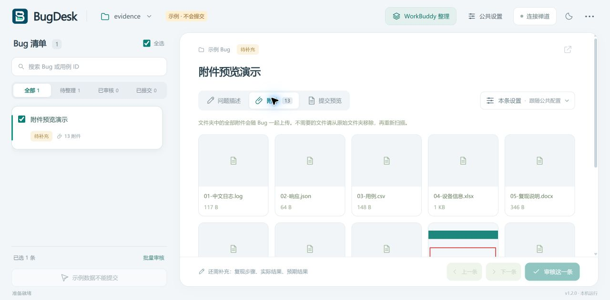
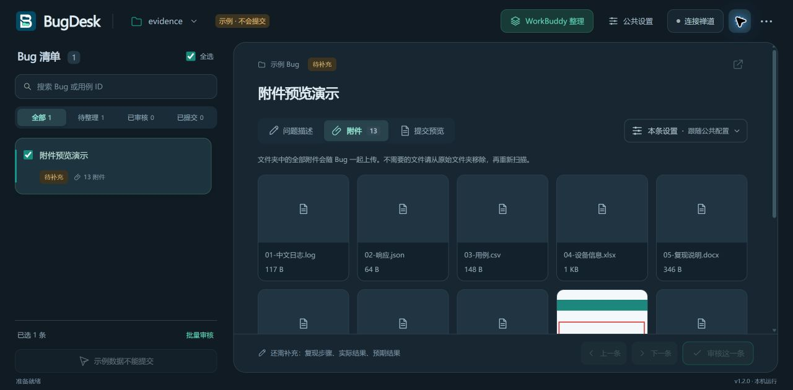
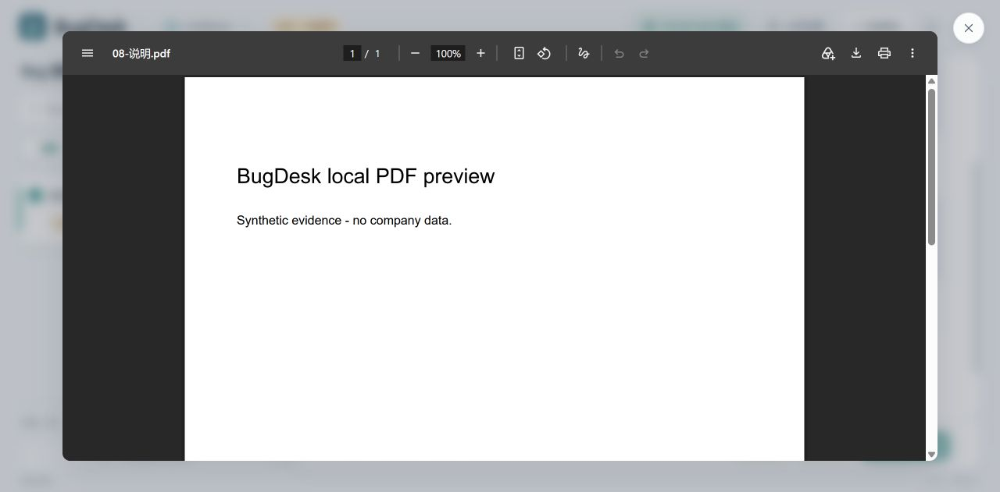
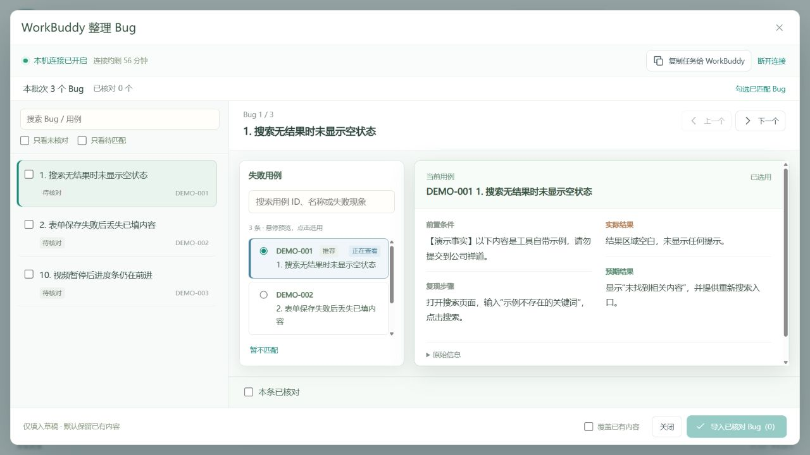
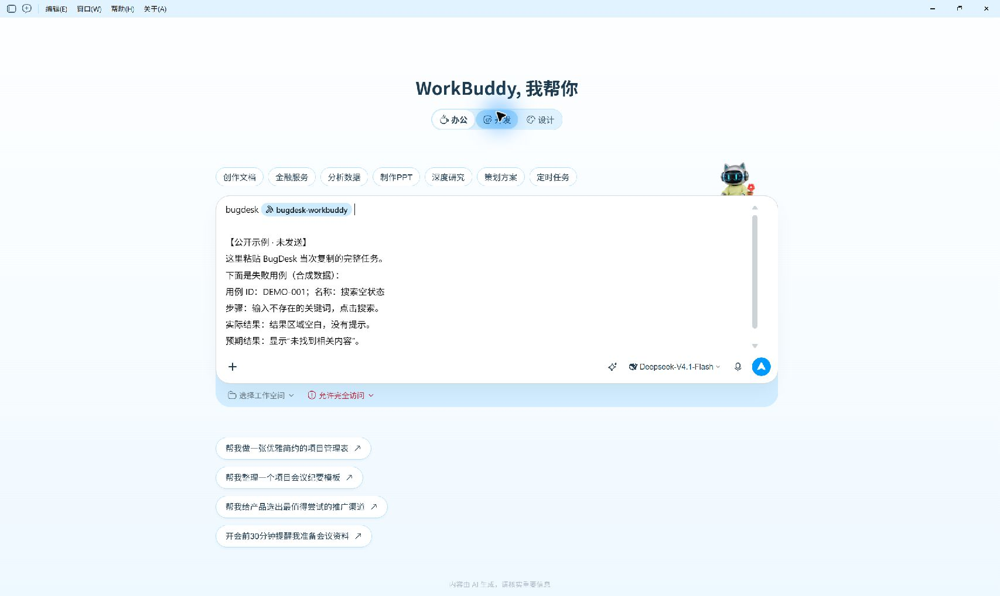
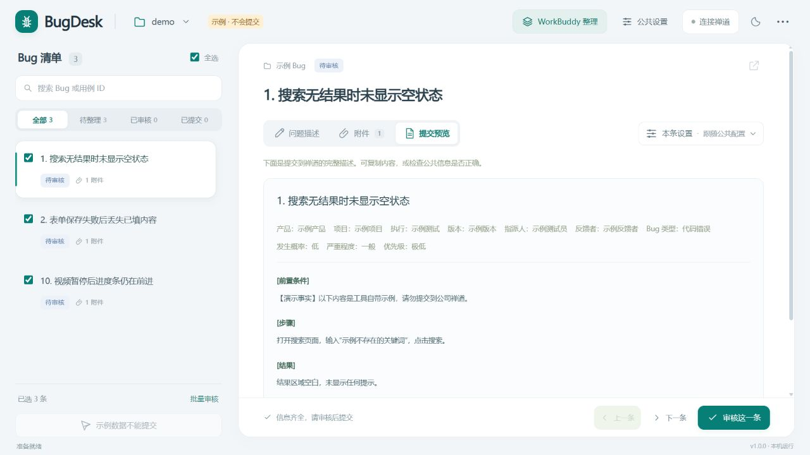

# BugDesk · Bug 提交助手

把测试现场的 Bug 文件夹，整理成可核对、可提交的缺陷报告。

BugDesk 是面向 Windows 测试人员的本地工作台：每个子文件夹对应一条 Bug，自动关联截图和视频，再填写前置条件、复现步骤、实际结果与预期结果。可以离线整理和导出，也可以连接禅道，在人工审核后提交。

**Python 3.11+ · 标准库运行 · 无前端构建 · 浅色 / 深色模式 · MIT**

## 下载 1.2.0

软件与 WorkBuddy 技能配套发布为 **1.2.0**，本次新增多格式本机附件预览，简化为全部附件随 Bug 上传，并使用字母 B 新 Logo。继续支持多用例归并、目录重新关联、覆盖对比和导入撤销。

前往 [GitHub Releases](https://github.com/wenliu3/BugDesk/releases/latest) 下载：

| 文件 | 用途 |
| --- | --- |
| `BugDesk-Windows-1.2.0.zip` | 推荐。解压后双击 `BugDesk.exe`，草稿保存在旁边的 `BugDesk-data`。无需安装 Python。 |
| `BugDesk-1.2.0-Windows-x64.exe` | 单独的 Windows 64 位程序，双击运行；默认在 Windows 本地应用数据目录保存草稿。 |
| `BugDesk-WorkBuddy-Skill-1.2.0.zip` | 可选，导入 WorkBuddy 的配套技能包；不需要解压后再压缩。 |
| `SHA256SUMS.txt` | 下载文件的 SHA-256 校验值。 |

## 界面预览

以下截图全部使用合成示例，不包含真实项目、人员、账号或内网地址。WorkBuddy 画面展示技能选择和任务输入，不代表任务已发送或执行完成。

### 工作台：清单与附件区分别滚动



### 深色模式：一键切换并记住选择



### 附件预览：PDF 保留阅读工具，背景适度模糊



### WorkBuddy：核对用例，再导入草稿



### 在 WorkBuddy 中选择技能并输入任务



### 提交预览：检查公共信息与完整描述



## 可以做什么

- **扫描文件夹**：子文件夹名称作为初始标题，自动收集其中的图片、视频和其他附件，保留原始文件。
- **整理测试事实**：编辑四项描述，自动保存；扫描到的附件全部随 Bug 上传，不需要逐项勾选。不需要的文件请从原始文件夹移除后重新扫描。
- **查看多种附件**：图片、视频、音频可直接查看，PDF 使用浏览器内置阅读器；日志、文本、CSV / TSV、Excel（XLSX）、Word（DOCX）/ PPT（PPTX）正文与 ZIP 文件清单均可在本机预览。预览直接显示内容，点击外部或按 Esc 退出。Office 为内容预览，完整排版和不支持的格式可在原始文件夹中用本机应用查看。
- **复用公共配置**：产品、版本、指派人、反馈者等整批复用；个别 Bug 可在「本条设置」中单独覆盖。
- **粘贴用例**：读取 HTML 表格、TSV 和多行单元格，核对字段与关联后填入草稿。
- **可选 WorkBuddy 整理**：结合原始备注、Bug 文件夹标题和用例事实，自行将同一 Bug 的多条失败用例整理为一份报告，保留全部来源；人工核对后导入，不自动审核或提交。
- **审核与提交**：查看完整报告，审核后连接禅道提交；首次实际提交限制为一条。
- **导出与迁移**：导出 Markdown、CSV 或 JSON 备份，支持重新导入。
- **改名后沿用草稿**：扫描前核对新旧文件夹对应关系，保留原描述、来源和禅道编号；整个日期目录搬迁后也可以重新关联。
- **核对覆盖与撤销**：WorkBuddy 导入前查看逐字段差异，覆盖时确认完整变化；可撤销最近一次导入，恢复前的内容并重新审核。

## 快速开始

源码运行需要 **Windows、Python 3.11 或更新版本，以及现代浏览器**。日常运行只使用 Python 标准库，无需安装额外依赖。

```powershell
git clone git@github.com:wenliu3/BugDesk.git
cd BugDesk
python app.py
```

也可以双击仓库中的 **启动开发版.cmd**。它优先使用指定的解释器，再尝试 Windows Python Launcher 和 PATH 中的 Python，草稿保存在项目的 `.local` 目录。

首次打开时点击 **先试试示例数据**，即可体验完整界面。示例数据不能提交到禅道。

如果 `python` 不是 3.11 或更新版本，请选择正确的解释器；Windows Python Launcher 用户可使用 `py -3.11 app.py`。

## 日常使用

建议按日期整理附件目录：

```text
Bug 附件/
└─ 2026-10-18/
   ├─ 搜索无结果时未显示空状态/
   │  └─ 截图.png
   └─ 保存失败后丢失已填内容/
      ├─ 截图.png
      └─ 录屏.mp4
```

1. 选择日期文件夹，点击「扫描 Bug」。
2. 填写公共设置，补齐每条 Bug 的测试事实；需要时通过「更多」粘贴用例。
3. 检查图片、视频和「提交预览」，确认事实正确后审核。
4. 导出报告，或连接自己的禅道并提交已审核条目。

右上角月亮 / 太阳按钮切换主题；「更多」中提供 WorkBuddy 使用说明、导出、备份和关闭工具等操作。

| 快捷键 | 操作 |
| --- | --- |
| `Ctrl + S` | 立即保存 |
| `Ctrl + Enter` | 审核当前 Bug |
| `Alt + ↑ / ↓` | 切换相邻 Bug |

## 可选：接入 WorkBuddy

从 [Releases](https://github.com/wenliu3/BugDesk/releases/latest) 下载 `BugDesk-WorkBuddy-Skill-1.2.0.zip`，按 WorkBuddy 客户端的技能导入流程安装。技能源码位于 [integrations/bugdesk-workbuddy](integrations/bugdesk-workbuddy)，`SKILL.md`、`scripts` 和 `references` 位于技能 ZIP 根目录。

在 BugDesk 扫描 Bug 后，开启「WorkBuddy 整理」中的本机连接，复制当次任务并附上失败用例。WorkBuddy 会依据相同或语义相关的原备注，结合 Bug 文件夹标题和各用例事实判断归属；备注无需与标题逐字一致。同一 Bug 的多条用例由 WorkBuddy 组合成一份完整报告：仅输入不同、流程和结果相同的，用公共步骤加完整 query / 参数清单，共同结果只写一次；条件、流程或结果有差异时再分组，例外单列。全部输入原句与来源保留供核对。每个已匹配 Bug 最多回传一份建议，归属不明时保持待核对，不新建 Bug。

等建议回传后，逐条核对四项报告、关联依据和所有来源，再导入草稿，无需自己多选组合。仅有相同管理标签、泛化“失败”或相似标题不能确定同一问题；缺失和冲突保留在待确认事项中。导入后保留全部关联用例元数据，便于回归查找。使用多用例功能时，请将程序与技能同步更新至 1.1.0 或更高版本；旧的单用例建议仍兼容。

「导入前后对比」按当前补空白或覆盖模式显示实际变化；已有内容被覆盖时会先汇总展示全部选中 Bug 的变化。导入后可在 WorkBuddy 窗口使用「撤销上次导入」，关闭连接或重启程序后仍可恢复最近一次导入前的四项描述和来源。之后若又编辑了目标 Bug、改了公共设置或附件，或尝试过提交，撤销会被阻止，以保留后续工作；恢复后需要重新审核。

如果改过 Bug 子文件夹名，或移动了整个日期目录，选择新位置扫描时可以在「关联原来的 Bug」中显式选择旧记录。默认作为新 Bug；也可选定旧日期目录后点击同名匹配，再核对确认。关联保留编辑后的标题与提交记录，并重新读取新位置附件，不移动或改写原始证据。一次最多关联 300 条且来自同一旧批次；预览有数量上限，超出部分会明确提示。

连接最长有效 60 分钟；技能只能读取受限上下文并暂存建议。是否把测试资料发送给 AI 服务，由你和所使用的客户端决定。使用前请确认资料允许发送到相应服务。

详细步骤见 [WorkBuddy 接入说明](WorkBuddy接入说明.txt)。

## 禅道兼容范围

连接器基于禅道 **18.11 经典页面接口**实现，包含登录、菜单读取、附件上传以及创建后核验，并使用本地模拟服务测试。

不同部署的单点登录、验证码、定制字段、权限和附件限制可能需要适配；本项目不保证所有禅道版本直接兼容。首次提交仅允许一条，确认编号和附件后再继续批量操作。结果不确定的条目需要人工核对，避免重复创建。

## 数据与隐私

- 服务仅监听 `127.0.0.1`，整理、预览和导出可离线完成。
- 扫描不会移动、删除或改写原始 Bug 证据文件。
- 源码开发启动器使用项目 `.local`；直接运行默认使用 Windows 本地应用数据目录。
- 自行打包的便携版在 `portable.flag` 同目录的 `BugDesk-data` 保存草稿和配置。
- 禅道密码与登录会话仅保存在当前进程内存；AI 整理不需要禅道账号。
- 本机草稿、连接文件、导出报告、IDE 配置、缓存和打包产物均不应提交到仓库，已设置相应忽略规则。

## 开发与检查

```powershell
python -m unittest discover -s tests -v
node tests/test_web_behavior.js
node tests/test_relink_web.js
node tests/test_attachment_preview_web.js
```

Python 测试使用本地文件和模拟服务，不连接真实公司系统。前端检查需要 Node.js，运行程序本身不需要 Node.js。

修改 `web` 后刷新浏览器即可；修改 Python 后需要重新启动程序。详见 [开发运行说明](开发运行说明.md) 和 [接口与行为约定](CONTRACT.md)。

## 自行打包 Windows 程序

```powershell
python -m pip install -r requirements-build.txt
python build_windows.py --release 1.2.0
```

产物生成在 `release` 目录，包含便携版 ZIP、单独的 EXE、配套技能 ZIP 和校验值。脚本会核对软件与技能版本，并只收集明确列出的交付文件。生成的 EXE、用户数据和发布压缩包不纳入源码提交。

## 许可证

本项目采用 [MIT License](LICENSE)。
